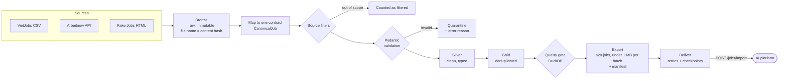
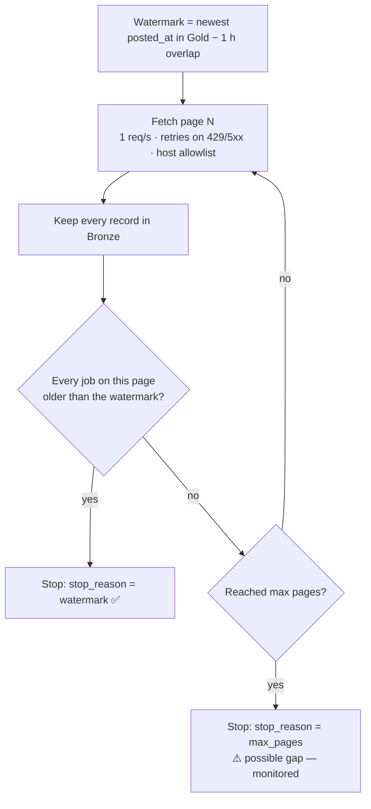
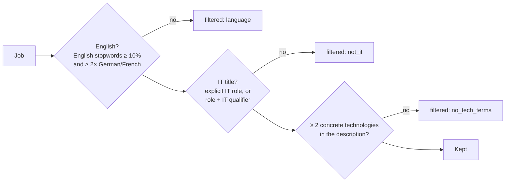
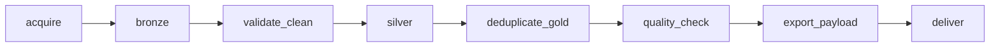
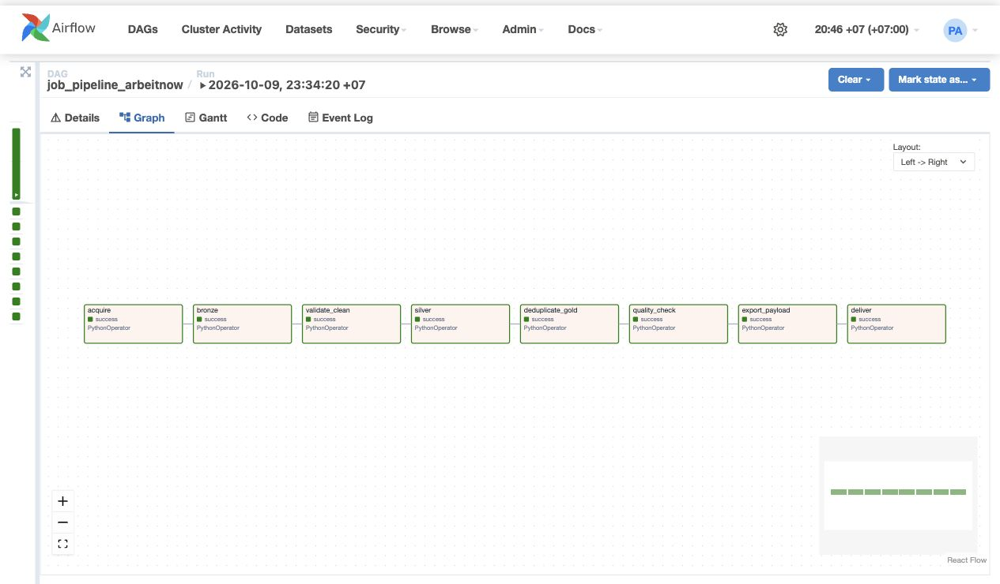
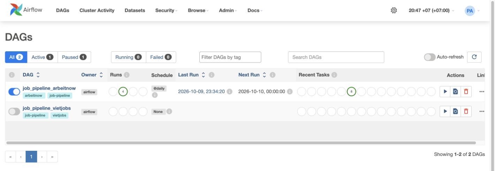

# Job Data Pipeline

**Turns messy job data from a CSV dump and a live job-board API into clean, deduplicated,
delivery-ready records — and never sends the same job twice.**

A batch data-engineering pipeline with a **Bronze → Silver → Gold** medallion design,
Airflow orchestration, incremental loading and checkpointed delivery to an LLM platform.

[](https://github.com/levienbang/data-ingestion-preprocessing/actions/workflows/ci.yml)


> Clean jobs are delivered to the **[AI Career Intelligence Platform](https://github.com/levienbang/ai-career-platform)**,
> which extracts skills with an LLM, powers semantic search and matches CVs.

---

## At a glance

| Source | Type | Raw | Kept | Why the rest is dropped |
|---|---|---|---|---|
| **VietJobs** | Published CSV (48,092 rows, 103 MB) | 48,092 | **≈2,000 IT jobs** | Not IT (category + strict title rules) |
| **Arbeitnow** | Live JSON API, paginated | 1,050 (6 pages) | **140 after dedup** | Not English, not an IT role, or no concrete technologies |
| **Fake Jobs** | HTML scraping practice site | — | — | Crawler with allowlist and 1 req/s rate limit |

- **207 offline tests** run in CI on every push — fixtures and mocked HTTP, no network or paid APIs.
- **Re-runs are safe:** running the pipeline 10 times produces the same Gold and sends nothing twice.

---

## Pipeline



Every source only implements two things: **read raw records** and **map them to the shared
contract**. From Bronze onward the same code handles all sources, so adding a fourth source
is one new file in `sources/` plus one line in a registry.

## Incremental loading from an API with no cursor

Arbeitnow has no increasing ID, no `since` parameter, and returns pages that are **not strictly
time-ordered** (blocks are sorted separately and concatenated). The pipeline handles it like this:



Stopping at the **first** old job would miss newer jobs placed later in the feed; re-reading a
few pages is free and the Gold dedup (by `slug`) absorbs the overlap.

## Precision-first filtering

Missing a few IT jobs is acceptable; letting a non-English or non-IT job reach the paid LLM
step is not. A job must pass **three independent checks**:



Each run logs counts per reason and **warns when the kept share drifts** outside 3–50%,
which usually means the source changed its format.

---

## Never send a job twice

| Layer | Mechanism |
|---|---|
| Bronze | File name is the content hash; written once, never overwritten |
| Gold | Dedup key = (source, source ID), or a hash of the full record when there is no ID |
| Export | Skips records already `accepted` (per-record checkpoint in PostgreSQL) |
| Deliver | A batch still `sending` is not re-sent within the safety window |
| Receiver | The AI platform deduplicates again by raw hash, URL and content hash |

Delivery is **at-least-once with an idempotent receiver**: transient errors (timeouts, 429, 5xx)
retry with back-off, 4xx errors do not, and each job ends as `accepted`, `rejected` or `blocked`.

## Orchestration





*An existing successful Arbeitnow run across all eight pipeline tasks.*

One Airflow DAG per scheduled source, built from the same eight tasks:

| DAG | Schedule | Notes |
|---|---|---|
| `job_pipeline_vietjobs` | manual | Static CSV |
| `job_pipeline_arbeitnow` | `@daily`, 00:00 Vietnam time | Live sources use the real fetch time, not Airflow's logical date |



*The DAG list shows four successful Arbeitnow runs and eight successful recent tasks.*

Timestamps are stored in UTC; schedules and the Airflow UI use Vietnam time.

---

## Quick start

```bash
uv sync --extra dev
uv run pytest                                   # 207 tests, offline

# Run a source end to end (no delivery)
uv run python -m job_pipeline run --source vietjobs --csv data/VietJobs.csv
uv run python -m job_pipeline run --source arbeitnow

# Airflow + PostgreSQL metadata
cp .env.example .env && docker compose up --build -d   # UI: http://localhost:8080
```

Export and delivery (`python -m job_pipeline export / deliver`) need `PIPELINE_DATABASE_URL`;
see [docs/REFERENCE.md](docs/REFERENCE.md).

## Tech stack

| Layer | Tools |
|---|---|
| Ingestion | HTTPX, Beautiful Soup |
| Storage & transform | Polars, Parquet, DuckDB, Pydantic |
| Metadata | PostgreSQL 17, SQLAlchemy, Alembic |
| Orchestration | Airflow 2.10 (LocalExecutor), Docker Compose |
| Quality | Ruff, Pytest, GitHub Actions |

## Project layout

```
src/job_pipeline/
  sources/      vietjobs.py · arbeitnow.py · fake_jobs.py · technology.py (filters)
  stages.py     Bronze → validate/clean → Silver → Gold
  quality.py    DuckDB checks
  delivery.py   export batches + checkpointed HTTP delivery
  checkpoints.py · metadata.py   PostgreSQL run / batch / record state
  workflow.py   Airflow tasks        __main__.py   CLI
dags/           one DAG per source
tests/          fixtures + mocked HTTP
```

## Known limitations

- Arbeitnow can still miss jobs when more new postings arrive than `ARBEITNOW_MAX_PAGES` covers
  (visible as `stop_reason=max_pages`); running hourly or raising the page limit reduces it.
- Filters are rules, not a classifier: precise, but some IT roles with generic titles are skipped.
- No job expiry yet: postings removed from a source are not withdrawn downstream.

---

**Deeper details** — settings, Docker, delivery semantics, milestone notes: [docs/REFERENCE.md](docs/REFERENCE.md) ·
VietJobs profiling: [docs/VIETJOBS_INSPECTION.md](docs/VIETJOBS_INSPECTION.md)
